<p align="center">
  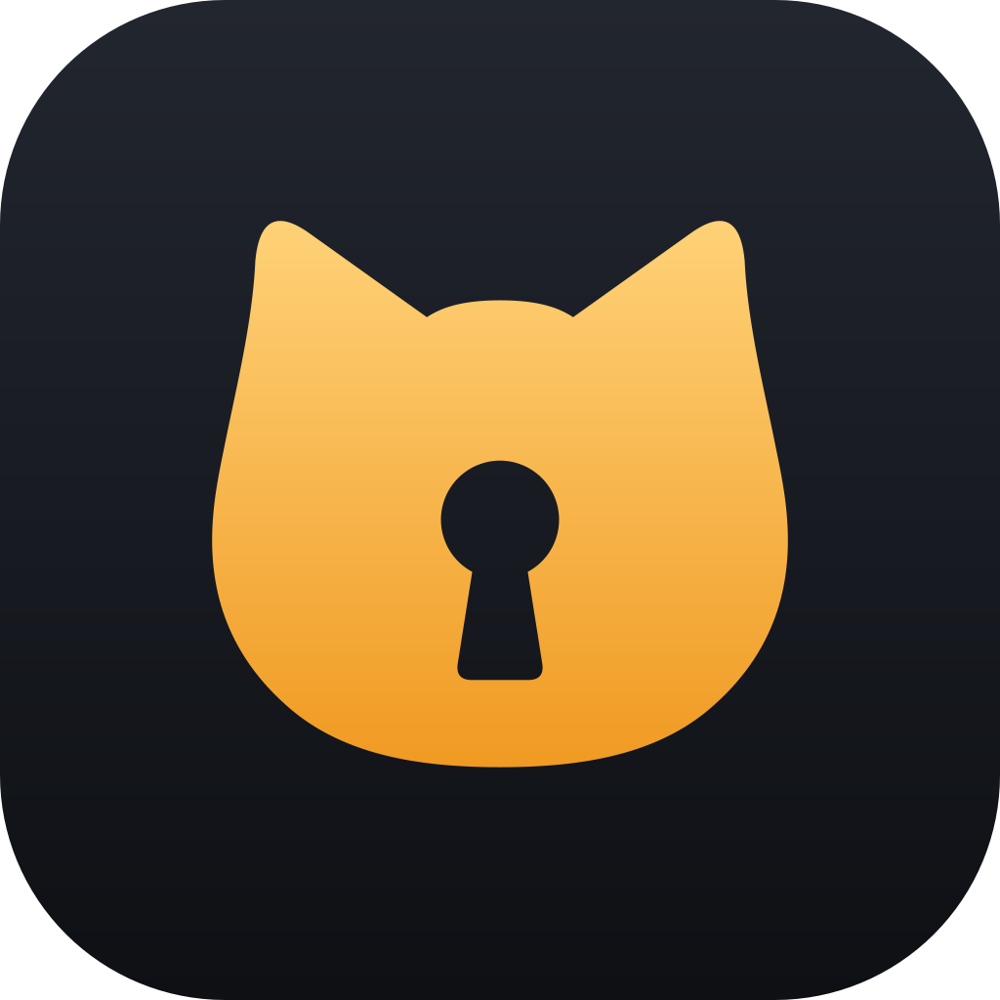
</p>

<h1 align="center">Keycat</h1>

<p align="center">
  <a href="https://github.com/vulpinepw/keykat/releases/latest/download/KeycatSetup.exe"><b>Download for Windows</b></a>
  &nbsp;&nbsp;·&nbsp;&nbsp;
  <a href="https://github.com/vulpinepw/keykat/releases/latest/download/keycat-linux-x86_64.tar.gz"><b>Download for Linux</b></a>
</p>

A browser for Windows and Linux where every profile is its own encrypted vault.

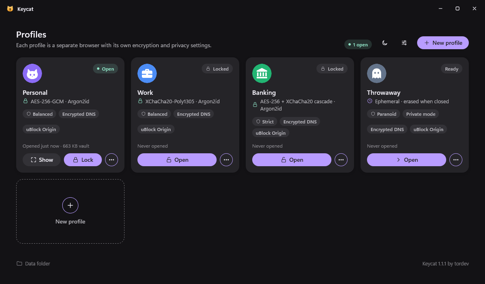

Each profile in Keycat is a complete, separate browser: its own history, cookies, logins, extensions and settings. When you close a profile, Keycat encrypts all of it into a single file and wipes the decrypted copy. When you open it again, you type its password, Keycat decrypts it, and you are back where you left off.

So your banking profile, your work profile and your personal one never see each other, and none of them can be read from the disk while you are not using them.

Underneath it runs the Firefox engine, so websites work the way they do in Firefox. Keycat adds the vaults, per profile privacy settings, a password manager that lives inside each vault, and it takes the Firefox branding, accounts, telemetry and promotions out.

It runs on Windows 10 and 11 (64-bit) and on 64-bit Linux desktops. Older versions and the checksums of every download are on the [releases page](../../releases).

## Contents

- [Using it](#using-it)
- [Installing and updating](#installing-and-updating)
- [How it works](#how-it-works)
- [Encryption](#encryption)
- [Building it yourself](#building-it-yourself)
- [Things to know](#things-to-know)
- [Credits and license](#credits-and-license)

## Using it

Keycat opens on the profiles window. Make a profile, pick how strongly it is encrypted and how private it should be, then open it. The profiles window steps aside while you browse and comes back when you lock the profile or close its last window.

<p align="center">
  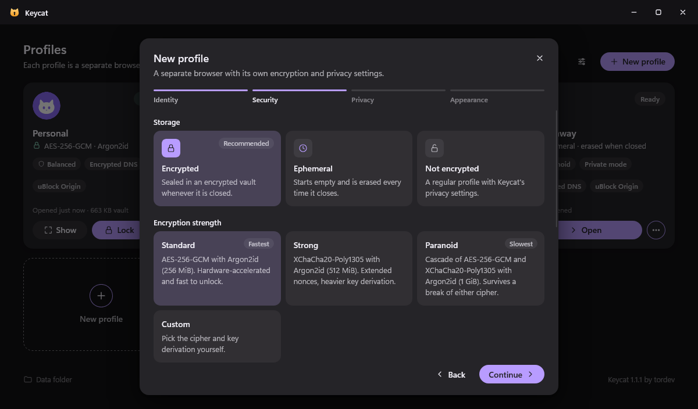
  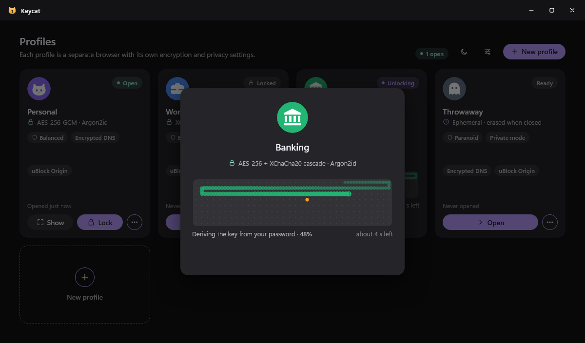
</p>

Opening an encrypted profile takes a moment, mostly for the key derivation, which is slow on purpose. A little snake shows how far along it is and how long is left. The same happens in reverse when the profile closes and gets sealed again.

Inside a profile it is a normal browser. The cat button in the toolbar shows which profile you are in and has the quick settings and the lock button.

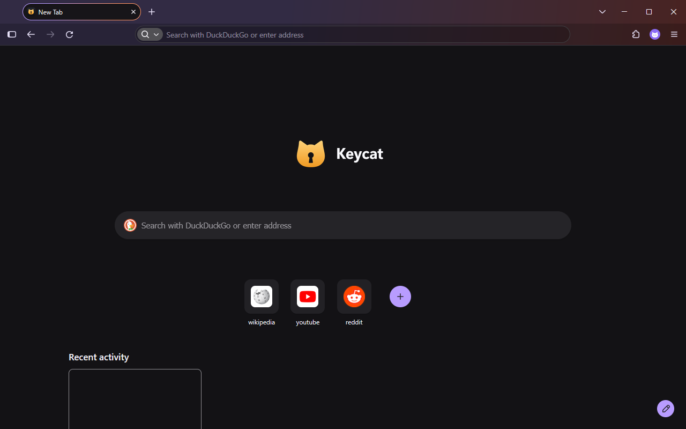

### Settings

Keycat's own settings are part of the browser's Settings page: this profile (name, picture, privacy, encryption, fake identity), Keycat Passwords, and all your profiles. Privacy changes apply to the open browser right away, no restart. The useful Firefox settings are still there below them; the ones that would undo Keycat's choices (Mozilla account, Sync, telemetry, its profile manager) are gone.

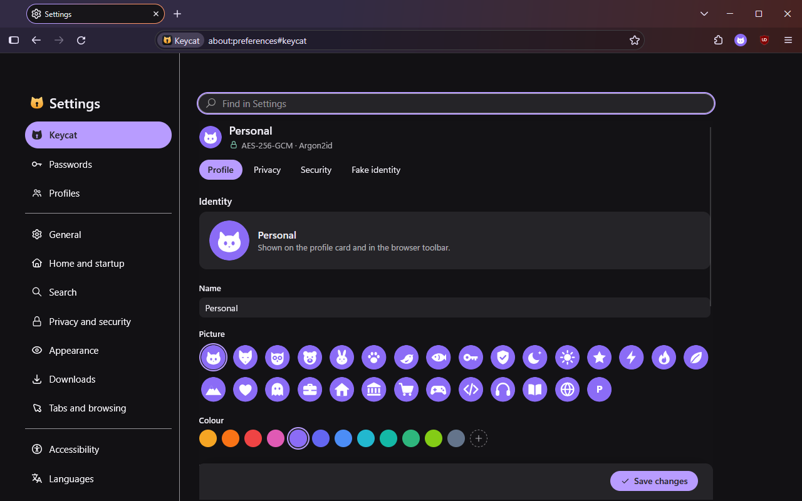

### Keycat Passwords

Every encrypted profile has its own password manager, stored in a separate file and encrypted with the same key as the profile. Under a login form it offers the logins it has for that site, on sign-up forms it offers a strong new password, and after you sign in somewhere new it asks whether to save the login. A login can be shared with another of your encrypted profiles.

<p align="center">
  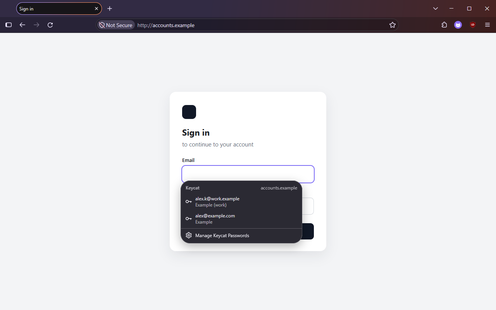
  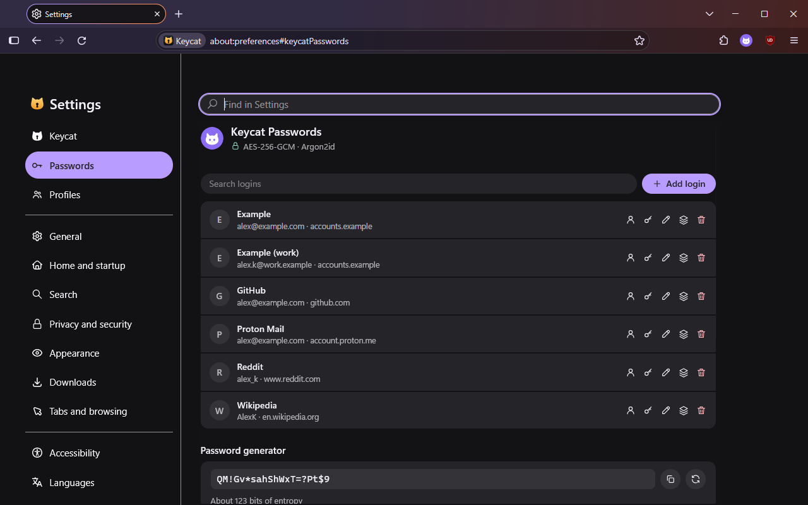
</p>

You can import passwords, bookmarks and history from Chrome, Edge, Brave, Opera and Vivaldi on the same computer, or from a CSV file. Imported passwords go straight into Keycat Passwords. Newer versions of Edge and Chrome on Windows encrypt part of their saved passwords so that only they can read them, and on Linux these browsers usually keep the key to their passwords in the system's keyring. Keycat tells you how many it could not read and how to bring them over with a CSV export from that browser.

### Privacy

Every profile has its own privacy settings. There are three starting points and you can change any single option afterwards:

- Balanced: strict tracking protection, fingerprinting scripts blocked and the rest blurred, cookies kept apart per site, HTTPS-Only, encrypted DNS (Quad9), no WebRTC IP leaks, no prefetching, Global Privacy Control, uBlock Origin.
- Strict: the same, plus third-party cookies blocked, cache in memory only, history forgotten when the profile closes, no search suggestions, and location and notifications blocked.
- Paranoid: always private browsing, nothing kept on disk, fingerprinting resistance with letterboxing, WebRTC and WebGL off, and a new random identity every time.

Fingerprinting is how sites recognise a browser from its screen, fonts, graphics and settings, without any cookie. A profile can block the scripts known to do it, also blur what the other scripts can measure (canvas, fonts, hardware), or resist it completely, so that it looks like every other browser doing the same.

A profile can also tell sites it runs on Windows, macOS or Linux, or a random one of them each time it opens. The user agent and what page scripts read both say so, and the browser keeps calling itself Firefox, as sites build their pages for the browser they see. Sites can sometimes still tell the real system from other details, and full fingerprinting resistance sends its own standard user agent instead.

There is also a fake identity per profile (name, e-mail, phone, address) for sign-up forms you would rather not give your real details to. Phone numbers come from ranges reserved for fiction and e-mails use example.com, unless you set up your own aliases.

Keycat has no account, sends no telemetry and shows no ads or recommendations. What still goes online by itself: Mozilla's security blocklists, certificate checks and add-on updates, uBlock Origin's filter lists, the hotspot login check in Balanced profiles, and a check for a newer Firefox engine when Keycat starts (you can turn that one off in Keycat's settings).

### Default browser

Keycat can be your default browser. In Keycat's settings, under Default browser, choose Make default. On Windows that opens Keycat's page in the default apps settings, where you choose Set default (Windows leaves that choice to you). On Linux it is done right away, or you can run `xdg-settings set default-web-browser keycat.desktop`.

A link from another app opens in the profile that is open. When none is, or several are, Keycat asks which profile to use and unlocks it first if it needs to. A setting next to Make default can send every link to one profile instead. Only web pages and files on your computer are taken from other apps.

## Installing and updating

### Windows

Run `KeycatSetup.exe`. It installs for your Windows user only, no administrator rights needed, into `%LOCALAPPDATA%\Programs\Keycat`.

<p align="center">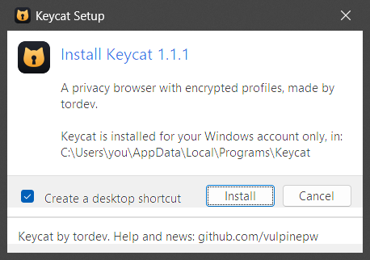</p>

The installer is not code signed, so Windows SmartScreen will probably warn you the first time. Choose "More info", then "Run anyway". If you want to be sure the file is the one from this page, compare its hash with the one in the release notes:

```powershell
Get-FileHash .\KeycatSetup.exe -Algorithm SHA256
```

Running a newer installer updates Keycat in place. Your profiles live in `%APPDATA%\Keycat` and `%LOCALAPPDATA%\Keycat`, not in the program folder, so an update never touches them. If Keycat is open, the installer locks your open profiles first (they get encrypted the normal way), closes Keycat, updates it and opens it again.

Uninstalling removes the program and keeps your profiles, unless you tick the box to delete them and confirm.

For a portable copy, put an empty file named `portable` next to `Keycat.exe`; everything is then kept in a `Data` folder beside it.

Both the installer and the uninstaller can run silently:

```powershell
.\KeycatSetup.exe --silent --close-running
& "$env:LOCALAPPDATA\Programs\Keycat\uninstall.exe" --silent
```

### Linux

Unpack the download and run the install script, as yourself rather than root:

```sh
tar -xf keycat-linux-x86_64.tar.gz
cd keycat
./install.sh
```

Keycat goes into `~/.local/share/keycat`, gets an entry in your applications menu and a `keycat` command in `~/.local/bin`, and opens. It needs what Firefox needs: a 64-bit desktop with glibc and GTK 3, on X11 or Wayland. To check the download against the hash in the release notes:

```sh
sha256sum keycat-linux-x86_64.tar.gz
```

Running `install.sh` from a newer download updates Keycat in place. Your profiles are in `~/.config/keycat` and `~/.local/state/keycat`, so an update never touches them, and an open Keycat gets the same care as on Windows: its open profiles are locked and encrypted before it closes.

To remove Keycat, run `~/.local/share/keycat/uninstall.sh`. It asks before deleting your profiles and keeps them unless you say yes; `--keep-data` and `--delete-data` answer for you.

You can also skip the install and start `./keycat` right from the unpacked folder. With an empty `portable` file next to it, everything stays in a `Data` folder there.

## How it works

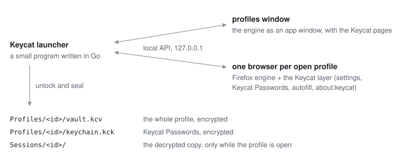

The launcher (`Keycat.exe` on Windows, `keycat` on Linux) is a small program written in Go. It ships a copy of the Firefox engine in `core` and adds a thin layer to it: a startup script, a few privileged modules, enterprise policies, and Keycat's own strings, images and pages, swapped into the engine's resource archives. The engine's programs and libraries are left alone, so their signatures stay valid (streaming sites check them for protected video).

The launcher serves the Keycat pages on a local address that only answers with the right token, and shows them in a window of the same engine. When you open a profile, it unlocks the vault, writes that profile's preferences and starts the browser on the decrypted folder. Inside the browser, the same pages show up in Settings and at `about:keycat`.

Keycat keeps the engine up to date itself. It downloads new Firefox versions from Mozilla and checks them before use: Mozilla's code signature on Windows, the checksums Mozilla signs for every release on Linux.

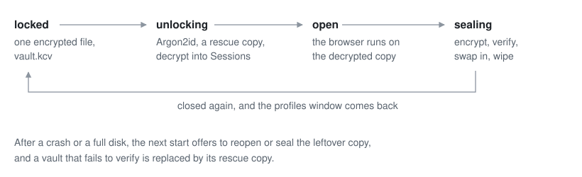

A vault is never changed in place. Before a profile is decrypted, Keycat keeps a rescue copy of its vault (a hard link, so it costs no time or space) until the profile is safely sealed again. Sealing writes a new vault next to the old one and decrypts it once more to check it, and only then replaces the old file. If the power goes out halfway, the next start finds what was left and puts things right.

Where things are kept:

| What | Windows | Linux |
| --- | --- | --- |
| each profile: `profile.json`, the vault, Keycat Passwords | `%APPDATA%\Keycat\Profiles\<id>` | `~/.config/keycat/Profiles/<id>` |
| logins shared between profiles, encrypted for each of them | `%APPDATA%\Keycat\Shared` | `~/.config/keycat/Shared` |
| the decrypted copy of each open profile | `%LOCALAPPDATA%\Keycat\Sessions` | `~/.local/state/keycat/Sessions` |
| the small profile behind the profiles window | `%LOCALAPPDATA%\Keycat\Hub` | `~/.local/state/keycat/Hub` |
| `keycat.log` | `%LOCALAPPDATA%\Keycat\Logs` | `~/.local/state/keycat/Logs` |

## Encryption

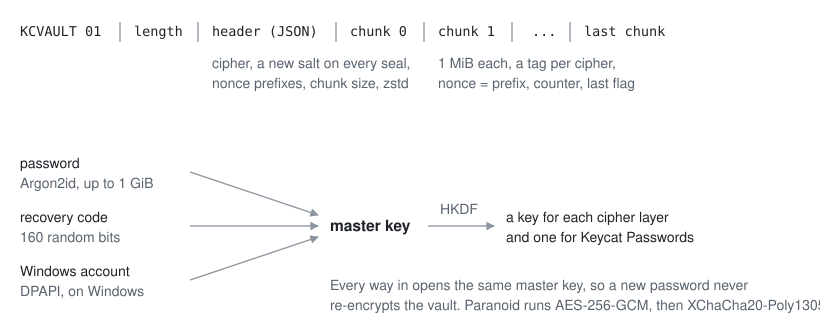

A vault is the profile folder packed into one archive, compressed with zstd and encrypted in 1 MiB chunks with an AEAD cipher (the STREAM construction). Every chunk is authenticated and tied to the vault's header, and the last one is marked, so a vault that was cut short, reordered or edited will not open.

The key that encrypts the vault is random. Your password, the recovery code you get when you make a profile and, on Windows if you want, your Windows account each unlock their own copy of that key. That is why changing the password is instant, and why the recovery code works even if you forget the password.

| Strength | Cipher | Key derivation |
| --- | --- | --- |
| Standard | AES-256-GCM | Argon2id, 256 MiB |
| Strong | XChaCha20-Poly1305 | Argon2id, 512 MiB |
| Paranoid | AES-256-GCM, then XChaCha20-Poly1305 | Argon2id, 1 GiB |
| Custom | any of the above or ChaCha20-Poly1305 | Argon2id, scrypt or PBKDF2-SHA512 |

The cipher can be changed later; Keycat re-encrypts the vault, which takes a few seconds.

The vaults are the same on both systems: a profile folder copied from Windows to Linux, or back, opens with its password or recovery code.

## Building it yourself

You need Go 1.25 or newer. Node.js is optional; it runs the tests and checks the JavaScript once its comments are stripped.

On Windows, the engine is copied from an installed Firefox, and `windres` from MinGW or TDM-GCC adds the icon and version info if you have it:

```powershell
.\build.ps1              # dist\Keycat\Keycat.exe, ready to run
.\build.ps1 -Installer   # dist\KeycatSetup.exe
```

The first build copies the engine from `C:\Program Files\Mozilla Firefox` into `dist\Keycat\core`; pass `-FirefoxDir` to use another copy. To try a build without touching your real profiles, put an empty `portable` file in `dist\Keycat`.

For Linux, Keycat is put together with Firefox for Linux as Mozilla publishes it, for example [firefox-158.0.tar.xz](https://archive.mozilla.org/pub/firefox/releases/158.0/linux-x86_64/en-US/firefox-158.0.tar.xz), which you can check against that release's [SHA512SUMS](https://archive.mozilla.org/pub/firefox/releases/158.0/SHA512SUMS). It builds on Linux or on Windows:

```sh
./build.sh --firefox firefox-158.0.tar.xz                  # on Linux
.\build.ps1 -Linux -LinuxFirefox firefox-158.0.tar.xz       # on Windows
```

Either way you get `dist/linux/keycat`, ready to run (on Linux), and `dist/keycat-linux-x86_64.tar.gz`.

Tests:

```sh
go test ./internal/... ./tools/... ./cmd/...
node tests/e2e/e2e.mjs        # the launcher and a real browser, start to finish
node tests/e2e/autofill.mjs   # Keycat Passwords on local test pages
node tests/e2e/hub.mjs        # the profiles window coming and going
node tests/e2e/import.mjs     # importing from a fake Edge profile
```

The end-to-end tests run the browser headless, with their own temporary folders, and never touch your profiles. They test `dist\Keycat` on Windows and `dist/linux/keycat` on Linux, or the Keycat you give them, as in `node tests/e2e/e2e.mjs ~/keycat/keycat`.

The code, roughly:

| Folder | |
| --- | --- |
| `cmd/keycat` | the launcher |
| `cmd/keycat-setup` | the Windows installer and uninstaller |
| `linux` | the Linux install and uninstall scripts, the menu icons |
| `internal/vault` | key derivation, ciphers, the vault format |
| `internal/session` | opening, running and sealing profiles |
| `internal/keychain` | Keycat Passwords and sharing between profiles |
| `internal/profile` | profiles, presets, browser preferences |
| `internal/app` | the local API, the profiles window, engine updates |
| `internal/firefox` | finding and launching the engine, installing the layer |
| `internal/platform` | what differs between Windows and Linux: dialogs, windows, one Keycat at a time |
| `browser/` | everything added to the engine |
| `hub/` | the Keycat pages |
| `tools/` | icon renderer, release packers, comment stripper |
| `tests/e2e` | end-to-end tests |

## Things to know

- A profile is only protected while it is closed. While it is open, its decrypted copy sits in `%LOCALAPPDATA%\Keycat\Sessions` (`~/.local/state/keycat/Sessions` on Linux) and anything running as your user can read it.
- Unlocking with your Windows account is convenient, but then the profile is only as safe as your Windows sign-in. Linux has no such option: profiles open with their password or recovery code.
- Deleted files can not be reliably overwritten on an SSD. If that matters to you, use full disk encryption as well (BitLocker on Windows, LUKS on Linux).
- Task Manager lists the browser processes as "Firefox", and `ps` on Linux as `firefox`. Changing that would mean modifying the engine's program files, which breaks protected video on streaming sites.
- Websites see a normal Firefox user agent. That is on purpose: it keeps sites working and you look like everyone else.
- The Linux package is for 64-bit Intel and AMD processors (x86-64).

## Credits and license

Keycat is made by tordev ([github.com/vulpinepw](https://github.com/vulpinepw)). The browser engine is Mozilla Firefox. Everything Keycat uses from others, and their licenses, is listed in [CREDITS.md](CREDITS.md).

Keycat is licensed under the [Mozilla Public License 2.0](LICENSE).

Firefox is a trademark of the Mozilla Foundation. Keycat is an independent project and is not made or endorsed by Mozilla.
